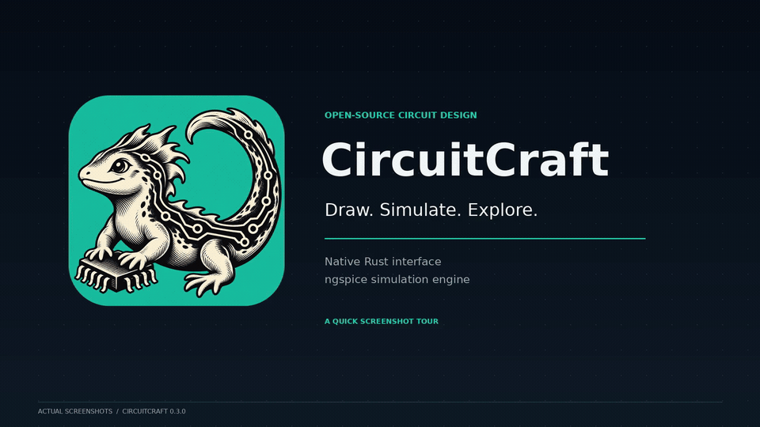
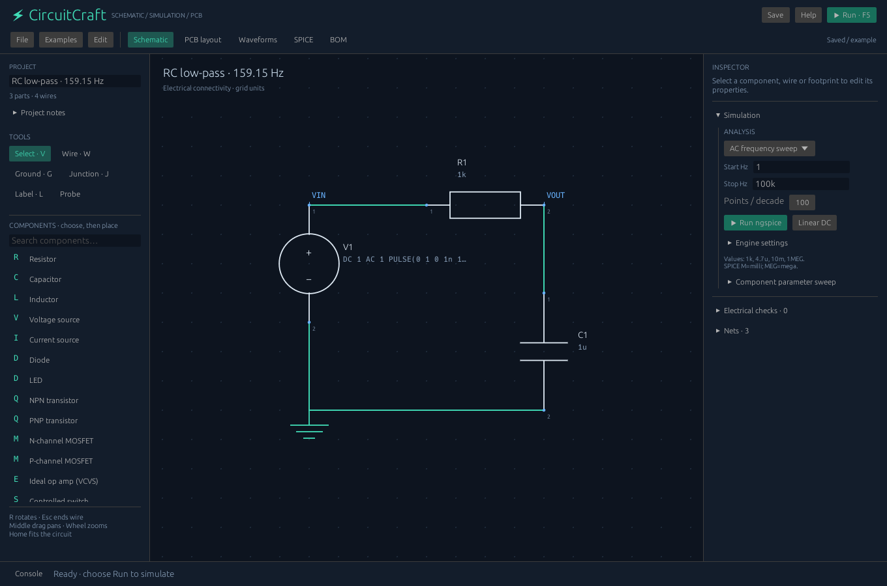
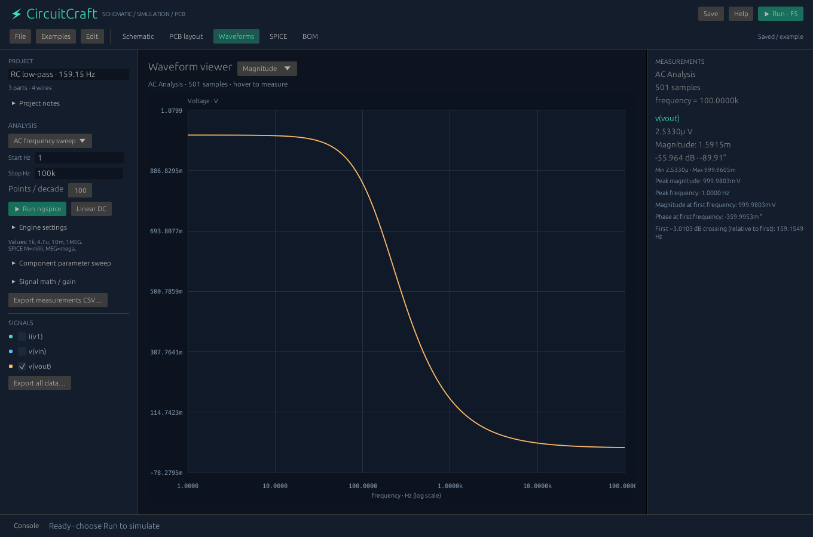
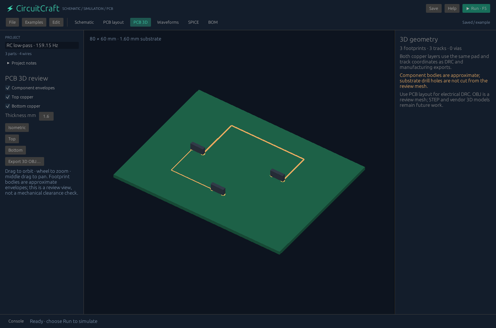

# CircuitCraft


**Draw a circuit. Simulate it with ngspice. Explore its PCB in 3D.**

CircuitCraft is a free, open-source desktop circuit design tool with a native Rust interface. It brings schematic editing, SPICE simulation and a two-layer PCB workflow into one application.

**[Download Windows 0.3.0 (ZIP)](https://github.com/Berserk-hub150/CircuitCraft/releases/download/v0.3.0/CircuitCraft-0.3.0-Windows-x64.zip)** · [Release notes and checksums](https://github.com/Berserk-hub150/CircuitCraft/releases/tag/v0.3.0) · [First circuit walkthrough](docs/FIRST_CIRCUIT.md) · [Italian quick start](LEGGIMI.md)

**MIT-licensed CircuitCraft code · Offline desktop workflow · No account required**





| Simulate and inspect waveforms | Review the PCB in 3D |
|---|---|
|  |  |

## Start on Windows

1. **[Download the complete Windows 0.3.0 ZIP](https://github.com/Berserk-hub150/CircuitCraft/releases/download/v0.3.0/CircuitCraft-0.3.0-Windows-x64.zip)** and extract **all** files and subfolders.
2. Open `Start-CircuitCraft.bat` or `windows/circuitcraft.exe`.
3. The RC low-pass example opens. Press **F5** to simulate its frequency response.
4. Change **R1**, run again and compare the curves. Open **PCB layout** and **PCB 3D** to inspect the board.

The **0.3.0 Windows release is available** and includes routing, hierarchical pages and PCB 3D review. The older 0.2 package does not include those additions.

Windows 10/11 x64 and a working graphics driver are required. Keep the extracted folder structure so the app finds its bundled ngspice engine. Linux builds from source; macOS compilation is not verified.

**[Follow the first-circuit walkthrough](docs/FIRST_CIRCUIT.md)** for an expected result, a parameter sweep and the PCB controls.

## What can you do?

- **Build schematics:** components, orthogonal wires, named nets, electrical checks, undo/redo and hierarchical pages.
- **Run real SPICE analyses:** operating point, AC, transient, DC sweeps, component sweeps and noise through ngspice.
- **Inspect signals:** waveform overlays, measurements, signal math and full-resolution CSV export.
- **Explore a PCB workflow:** two copper layers, manual routing, bounded autorouting, vias, design-rule checks and interactive 3D review.
- **Export your work:** SPICE, BOM, SVG, CSV, Gerber, Excellon drills and 3D OBJ.

CircuitCraft is an **early EDA project with a limited component library**. The autorouter can leave connections unresolved; 3D component bodies are approximate review envelopes. See the full scope and current limits below.

[Engineering workflows](docs/ENGINEERING_WORKFLOWS.md) · [Advanced features](docs/ADVANCED_FEATURES.md) · [Implemented scope](FEATURES.md) · [Validation](VERIFICATION.md) · [Roadmap](ROADMAP.md)

## Try it and share feedback

Start with the RC example, then try a circuit you understand. **[Report what worked or where you got stuck](https://github.com/Berserk-hub150/CircuitCraft/issues/new/choose)**: include your OS, app version, reproduction steps, and a small `.cforge` example or screenshot where possible.

Contributions are welcome in circuit examples, numerical validation, bug fixes, documentation and platform testing. Read [CONTRIBUTING.md](CONTRIBUTING.md). If you want to follow the project's development, you can star the repository.

## New in 0.3.0

| Feature | Working behavior |
|---|---|
| Two-layer autorouter | A* routing with real pad endpoints, copper/edge clearance, vias, preserved manual tracks, background cancellation and undo; partial routes reported explicitly |
| Hierarchical schematic pages | Nested embedded pages, explicit label-to-parent port bindings, isolated local nets, global ground and deterministic flattening for simulation/BOM/PCB |
| PCB 3D review | Depth-buffered orbit/zoom/pan, top/bottom/isometric views, saved board thickness, copper visibility and approximate component bodies |
| 3D export | Millimetre-scale OBJ from the same review geometry, via File or CLI |

[Controls, limits and examples](docs/ENGINEERING_WORKFLOWS.md).

## Added in 0.2.0

| Feature | Working behavior |
|---|---|
| Component parameter sweeps | Simulate 1–24 R/C/L values, overlay the chosen signal, retain the original design, cancel between runs and export all original samples |
| Automatic measurements | Min/max, peak to peak, time-weighted mean/RMS/integral, 10–90% transition, settling to the final sample, AC peak and first relative −3.0103 dB crossing |
| Noise analysis | Input/output small-signal density spectra and integrated RMS noise over the sampled band |
| Signal math | Complex difference, ratio and product; true output/input gain and transient voltage × current; plot and CSV calculated signals |
| Custom footprint editor | Pad coordinates, sizes, round/rectangular shape and drill; reusable JSON import/export; geometry shared by PCB, DRC and Gerber |
| Assembly exports | Footprint placement CSV, PCB review SVG and top SMD solder-paste Gerber |

See [Advanced features](docs/ADVANCED_FEATURES.md) for exact controls, units, interpolation and measurement definitions.

## Full implemented scope

| Area | Features |
|---|---|
| Schematic | Hierarchical embedded pages with explicit ports; grid, selection, placement, movement, rotation, duplication, deletion, orthogonal wires, junctions, ground, remote labels, undo/redo, pan/zoom |
| Components | R/C/L, voltage/current sources, diode, LED, NPN/PNP, NMOS/PMOS, ideal op amp, controlled switch, connector, four-pin subcircuit |
| Connectivity / ERC | Electrical graph, globally connected grounds, named remote nets, explicit crossing rules, missing ground, duplicate references, malformed values, dangling terminals |
| Simulation | ngspice operating point, AC, transient, DC source sweep, component sweep and noise; source waveforms, models, parameters, includes and subcircuits |
| Waveforms | Multiple traces, magnitude/dB/phase/real/imaginary, log frequency axis, cursor, min/max, peak-preserving plotting, full-resolution CSV |
| Rust solver | Modified nodal analysis for linear DC R/C/L/V/I, with singular-circuit diagnostics |
| PCB | Two copper layers, seven base footprints plus editable custom pads, schematic synchronization, pad snapping, placement/rotation, manual and automatic routing, plated vias, ratsnest, interactive 3D review |
| DRC | Shorts, copper clearance, edge clearance, minimum track width, unrouted pads, missing/stale footprints, unknown track nets |
| Exchange | 3D OBJ, SPICE, schematic/PCB SVG, BOM, waveform/measurement/sweep/placement CSV, copper/mask/paste/silk/outline Gerber and plated Excellon drills |
| Project / automation | JSON save/open, notes, textual SPICE workspace, CLI exports, validation, batch simulation and engine verification |

**This is an initial EDA release with a limited library. It does not claim full parity with every feature of KiCad, Altium, Proteus or other professional suites.** Copper pours, push/shove, linked external hierarchical sheets, graphical sheet-box symbols, manufacturer 3D models/STEP, native third-party project import and digital/MCU co-simulation remain future work. The autorouter is bounded and does not guarantee completion; 3D bodies are approximate review envelopes.

The UI, connectivity and linear solver are Rust. Advanced simulation uses **ngspice**, a separate C engine.

## Editing
Choose a part in the library and click the grid. **R** rotates its placement ghost. Select a placed part to edit reference, value, model, parameters and footprint. **Ctrl+D** duplicates; **Del** removes; **Ctrl+Z / Ctrl+Y** undo/redo.

**W** starts a continuous orthogonal wire; click terminals or grid points, and **Esc** finishes. **G** places ground, **J** a junction, **L** a named net. Middle drag pans, the wheel zooms, and **Home** fits.

Moving a symbol moves its terminals; connected wires require rerouting. Moving PCB footprints does not stretch tracks. Analysis settings and engine path are session settings; geometry, models, editable netlist, include root and notes are saved.

## Electrical rules
Crossing wire interiors remain separate unless a pin, label, wire vertex or explicit junction lies at the crossing. T endpoints on a wire connect. Grounds share SPICE node `0`; identical remote labels connect case-insensitively. Label characters are letters, digits and underscores.

SPICE: `k` = kilo, `M`/`m` = milli, `u` = micro, `n` = nano, **`MEG` = mega**. Scientific notation and parameter expressions are supported.

The ideal op amp is a linear VCVS: **OUT+, OUT−, IN+, IN−**. It lacks supply rails, saturation and bandwidth. MOSFETs expose a separate bulk pin. Generic models are demonstration models, not verified models of specific purchasable devices.

## SPICE workspace
Manufacturer `.model` and `.subckt` definitions, `.param`, `.include` and `.lib` go in the workspace. Imported `.cir` files are textual and do not reconstruct a graphical schematic or PCB. The checkbox and schematic banner identify the simulation source.

Use **Include base directory** for relative model paths; retain relative paths within vendor libraries or make them absolute. CircuitCraft owns analysis execution; `.control` scripts in the submitted netlist are rejected. Jobs run in a temporary directory with a 45-second limit, and stale results are discarded if the circuit changes.

## PCB and fabrication
Synchronize from the schematic, place footprints, route from pads, select Top/Bottom and insert vias. The first pad chooses the net. The footprint pad numbering follows **SPICE terminal order**, including C/B/E and D/G/S/B. Verify against the physical component datasheet.

Run DRC, then export from **File → Export Gerber + drills**. The destination is a folder name, and files are created inside it. Review all layers and pin mappings in an independent CAM tool before fabrication. The exported top silk contains component outlines. Top solder paste uses full SMD pad dimensions; adjust for your process. Assembly text is not generated.

## Build
Rust 1.88 or later:
```sh
cargo run -p circuitcraft
cargo build --workspace --profile dist
```
Linux: install ngspice and native X11/Wayland development dependencies for eframe. Zenity provides file selection; an in-app path entry is the fallback.
macOS compilation is not verified.

Windows from source (Python is needed only to unpack the original engine):
```powershell
python -m pip install py7zr
python scripts/prepare_engine.py
.\scripts\Build-Windows.ps1
.\scripts\Test-Windows-Engine.ps1
```

## CLI
```sh
cargo run -p circuitcraft-cli -- examples generated-examples
cargo run -p circuitcraft-cli -- validate examples/rc-lowpass.cforge
cargo run -p circuitcraft-cli -- export examples/rc-lowpass.cforge exported
cargo run -p circuitcraft-cli -- simulate examples/rc-lowpass.cforge ac ac.csv --start 1 --stop 100k --points 100
cargo run -p circuitcraft-cli -- simulate examples/rc-lowpass.cforge tran transient.csv --step 10u --stop 5m --uic
cargo run -p circuitcraft-cli -- sweep examples/rc-lowpass.cforge ac sweep.csv --component R1 --values 500,1k,2k --measurements sweep-measurements.csv
cargo run -p circuitcraft-cli -- simulate examples/rc-lowpass.cforge noise noise.csv --output VOUT --source V1 --measurements noise-measurements.csv
cargo run -p circuitcraft-cli -- simulate examples/rc-lowpass.cforge ac gain.csv --math-a 'v(vout)' --math-b 'v(vin)' --math-op ratio
cargo run -p circuitcraft-cli -- autoroute input.cforge routed.cforge --grid 0.5 --width 0.3
cargo run -p circuitcraft-cli -- pcb3d routed.cforge board.obj
cargo run -p circuitcraft-cli -- check-engine engine-report.txt --engine /path/to/ngspice
```
Windows also includes `windows/circuitcraft-cli.exe`.

## Verification
```sh
CIRCUITCRAFT_NGSPICE_TESTS=1 cargo test --workspace
cargo run -p circuitcraft-cli -- check-engine engine-report.txt
python -m pip install gerbonara
python scripts/verify_fabrication.py
```
Physics checks compare independent analytic values; GUI tests use real pointer events and egui frames. See [VERIFICATION.md](VERIFICATION.md).

## License and references
CircuitCraft: MIT, copyright Luca Magrini. Third-party code/binaries retain their licenses; original notices and ngspice source are included. See [THIRD_PARTY.md](THIRD_PARTY.md).
- https://ngspice.sourceforge.io/docs.html
- https://ngspice.sourceforge.io/download.html
- https://www.ucamco.com/en/guest/downloads/gerber-format
