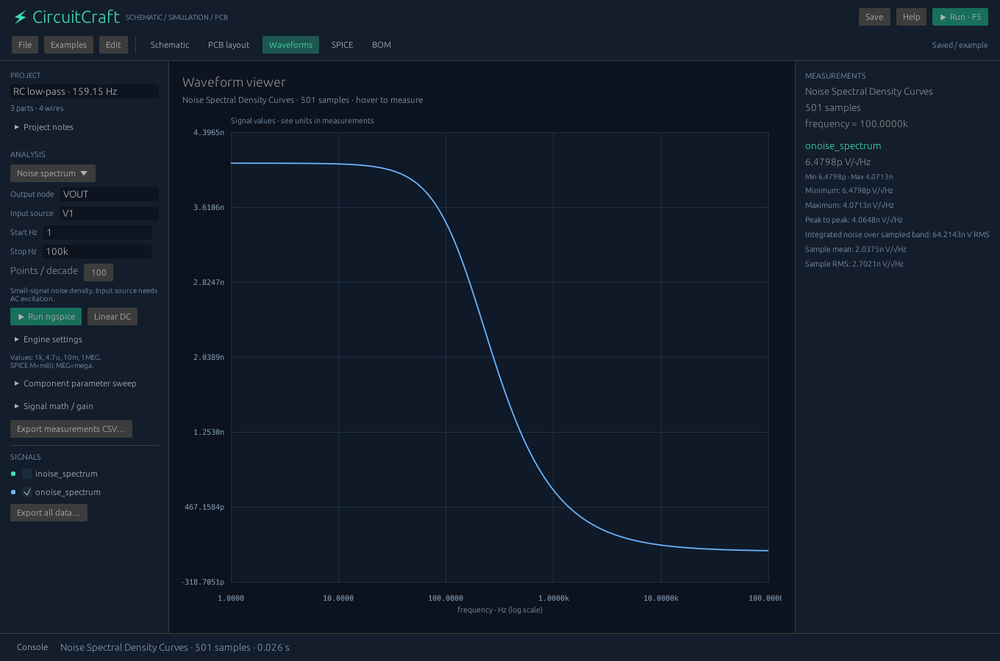

# CircuitCraft 0.2 — advanced workflows

## Component parameter sweep
Open **Waveforms** or the schematic's **Simulation** inspector. Expand **Component parameter sweep**, enable **Sweep when running ngspice**, choose an R/C/L reference and enter comma-separated values such as `500,1k,2k`. Choose an analysis and press Run.

Each value runs a real, separate ngspice job on a clone. The original design is unchanged. Choose the output signal below the sweep controls; the graph overlays one curve per value. **Export complete sweep CSV** retains every original sample, including each transient run's adaptive time axis. **Export measurements CSV** measures each original run.

Limits: 1–24 positive finite values; five million combined signal samples; 45 seconds per run. Cancellation occurs between runs. Graphical R/C/L sweeps cannot run in edited-netlist mode.

AC axes normally match exactly. Transient overlays use linear interpolation onto the first run's axis; graph/cursor statistics therefore describe the overlay, while exported sweep measurements use the unmodified original data. Different axis extents are rejected.

## Automatic measurements
Select plotted signals to view statistics in the right inspector.

| Measurement | Definition |
|---|---|
| Mean / RMS for transient | Integrals of the complete piecewise linear waveform divided by sampled duration; exact integration of each line segment's square for RMS |
| Integral | Time integral, in signal unit × seconds |
| 10–90% transition | First interpolated crossings of 10% and 90% between the first and final sample values; supports rising/falling transitions |
| 2% settling | Last departure from the band around the final sample, interpolated to its boundary |
| AC peak | Largest sampled complex magnitude, with its frequency |
| Relative cutoff | First downward −3.0103 dB crossing relative to the first frequency's magnitude; log-frequency/log-magnitude interpolation |
| Noise RMS | Square root of the integral of the squared noise density over the sampled frequency band |

These are sampled-data measurements. The final sample is not necessarily the true steady-state value; run long enough before interpreting transition or settling metrics. A non-monotonic response can have more than one cutoff; the reported crossing is the first.

## Noise spectrum
Choose **Noise spectrum** in Analysis. Enter the output node (e.g. `VOUT`), input source (e.g. `V1`), frequency range and points per decade. The source should have AC excitation. Run to view `onoise_spectrum` and `inoise_spectrum`. Output voltage noise is V/√Hz; input-referred noise follows the input source's voltage/current units. Device noise depends on the chosen models and temperature.

## Signal math
In Waveforms, expand **Signal math / gain**. Select A, B and an operation, then **Add calculated signal**.

- A − B: differential signal; units must match.
- A / B: complex ratio; identical units give a dimensionless result. Use output/input for actual gain and phase. Division by zero is rejected.
- A × B: mathematical product. Transient voltage × current is instantaneous power in W. AC complex products are phasor arithmetic, not an automatically calculated average real power.

Calculated signals appear in plots, measurements and waveform CSV. Re-running the analysis replaces derived signals. A sweep signal selection change rebuilds its overlay.

## Custom footprint library
Select a schematic component, expand **Custom footprint / pad editor**, and choose **Customize this footprint**. Edit pad X/Y, copper size, rectangular/circular shape and drill. A zero drill denotes a top-layer SMD pad. Circular pads have equal X/Y sizes. Positive drills must be smaller than their copper.

**File → Import footprint for selected part** and **Export selected footprint** share reusable JSON definitions. The pad count must match the selected symbol's SPICE terminals. Pad order is SPICE order, not an automatic datasheet mapping. The graphical symbol library currently supports 2–4 terminals.

Then open PCB and **Synchronize from schematic**. The editor, ratsnest, clearance checks, Gerber, paste and drills all use the custom pad geometry. Existing tracks remain in place and may need rerouting. Definitions are saved inside the project.

Example libraries: `examples/footprints/`.

## Assembly exports
**File → Export placement CSV** writes X/Y in millimetres from the PCB's bottom-left origin, rotations in degrees, and Top side. Every placed footprint is listed; the source symbols in demonstrations are external connections, not automatically selected purchasable parts.

**File → Export PCB SVG** creates a scalable review drawing with copper, pads and holes. Manufacturing exports include top solder paste for SMD pads, using full copper pad dimensions. Paste reduction, apertures for vias, assembly text and bottom-side SMD placement are not implemented.
